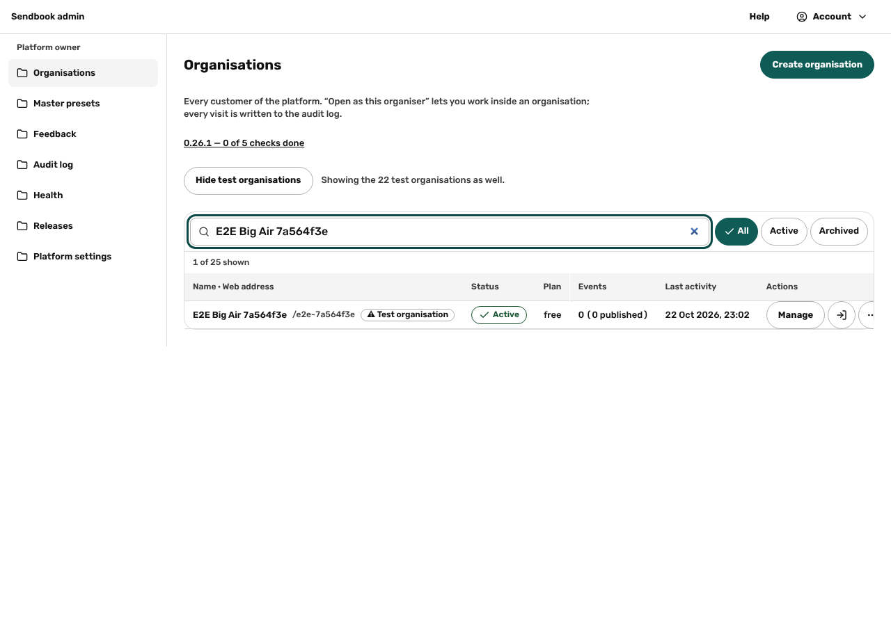
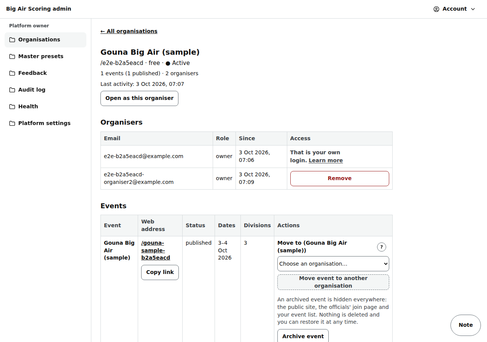
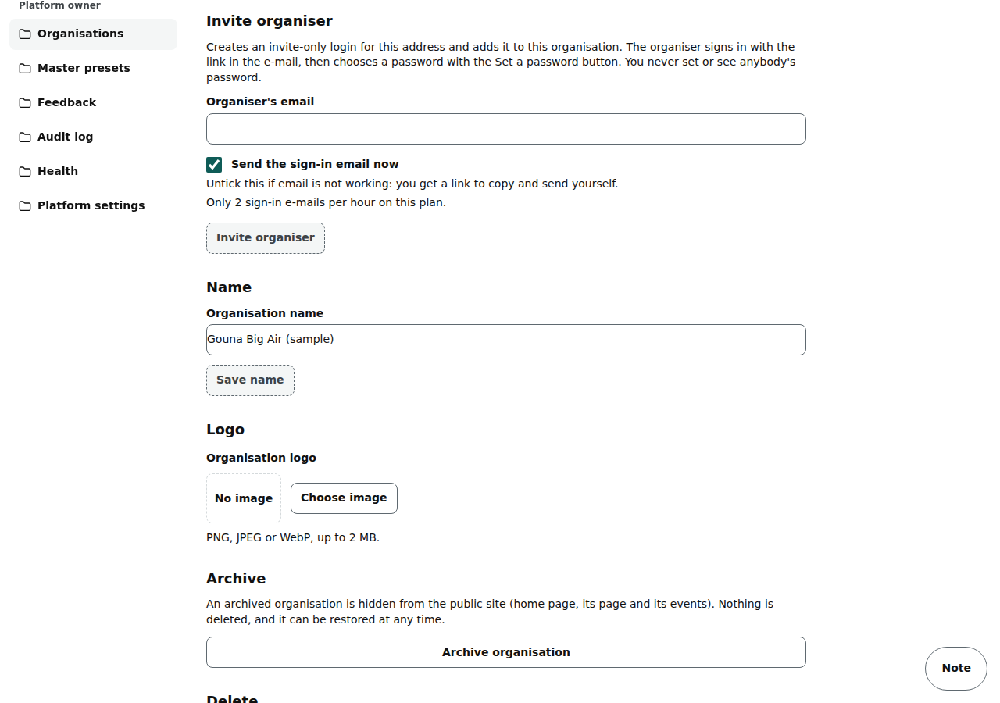

# Admin: organisations

/admin (platform owner and staff): every customer organisation, opening one as its organiser, creating organisations, inviting their first organiser, moving, archiving and deleting.

Last checked: 22 Oct 2026 · Product version 0.26.1

## What it is for {#ao-purpose}

The platform owner's control room. /admin answers “This page doesn't exist” to anybody who is not a platform owner or staff. Staff can look; changes need the owner (“Only platform owners can do this. You can look, but not change it.”).

*admin-organisations-1280.png — the organisations table with **Show test organisations** switched on, filtered to one test organisation (it carries the Test organisation tag).*

*admin-organisation-1280.png — one organisation's page: its organisers, with Remove (not on your own login).*

*admin-invite-1280.png — Invite organiser: e-mail, “Send the sign-in email now”, and the e-mail limit of the plan.*

## Controls {#ao-controls}

| Control | What it does |
|---|---|
| Version line | “‹version› — ‹n› of ‹n› checks done” (or “— tested”) above the table: the current version's testing; tap it to open [Releases](admin-releases.md). |
| Table | Name, web address, status, plan, events (“4 (2 published)”), last activity; **Search organisations**, **Status** filter. Test organisations are left out until you press **Show test organisations**; with them shown each carries a **Test organisation** tag. |
| {#ao-test} **Show test organisations** / **Hide test organisations** | Above the table (only while some organisation is labelled as test): the note says how many are hidden. Test organisations are the ones the automated tests make, and the Demo organisation. They never appear on the public site, whether or not their events are published. The switch only changes what this list shows; nothing is changed or removed. |
| Row: **Manage**, **Open as this organiser**, menu (**Rename**, **Archive** / **Restore**, **Delete**, **Invite organiser**) | Opening as an organiser shows the slim strip “Viewing as ‹organisation›” with **Back to admin**; every visit is in the audit log. |
| **Create organisation** | Name, web address (slug, for /o/‹slug›), default time zone, logo. |
| Organisation page: **Organisers** | Who can sign in, with role and since when, and **Remove** (owner only). |
| {#ao-invite} **Invite organiser** | E-mail → **Invite organiser**. **Send the sign-in email now** (untick it when e-mail is not working: you get a link to copy). The form says “Only 2 sign-in e-mails per hour on this plan.”; the confirmation says “Ask them to click the link today and set a password straight away.” The link works once, for 24 hours, in any browser, and lands them in their organisation; they then choose their own password. When the e-mail could not be sent the sentence says why (limit used up, or the built-in sender only writes to your own team) and shows the link to send yourself. |
| **Organisers** → **Remove** | Owner only (not your own login): their access ends at once and every phone or computer they are signed in on is signed out; the login stays, so you can invite them again later. |
| **Events** | The organisation's events; **Move event to another organisation** (not while a heat runs; riders matched by email or copied); delete / archive an event. |
| **Archive organisation** / **Restore organisation** | Hidden from the public site; nothing deleted. |
| **Delete organisation permanently** | Type the web address; only while no result was published. |
| **Demo data** → **Create demo organisation** | Builds “Demo Cup” (fictional riders, officials, draw) when no demo exists; hidden on a project with DEMO_SEED_DISABLED. Its PINs are public: development only. |
| **Events** → **Restore results from ‹date›** | After an event Reset, the 30-day copy can be restored by the owner ([Resets and undo](../resets-and-undo.md#ru-restore)). |

## Test organisations {#ao-test-orgs}

An organisation is **labelled as test** by a label on the organisation itself (not by its name). A test organisation keeps every event, rider, login and file it has; the label only keeps it off the public home page, the event code box, public results pages, its public organisation page and this list's default view. Organisations that the automated tests create are labelled when they are created, so they cannot reach the public site even if their events are published. Arrow, Redbull and EKL are real organisations and are not labelled.

To label or unlabel one, from the project folder: `npm run orgs:test -- mark <web address>`, `npm run orgs:test -- unmark <web address>`, or `npm run orgs:test -- list` to see which are labelled. The script refuses Arrow, Redbull and EKL. The helper that removes a whole organisation (used only for test clean-up) refuses every organisation that is not labelled as test.

**The phone preview is public while it runs.** `npm run preview:public -- create` makes a throwaway event so you can look at the public site on a real phone. A phone can only look at a public event, so this one is **public while it runs**: it is not labelled as test, it appears on the home page list, and anybody can open it. Remove it with `npm run preview:public -- remove <code>` when you are done; that labels it as test again just before it removes it.

## What it depends on {#ao-depends}

A platform owner or staff login (`npm run bootstrap:platform-admin`). Email limits of the hosting plan for invitations.
