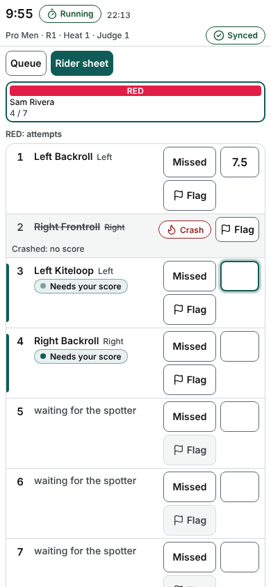
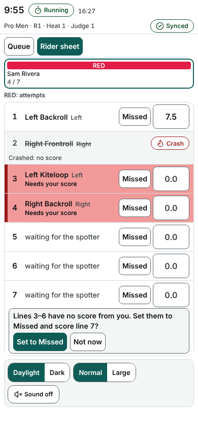
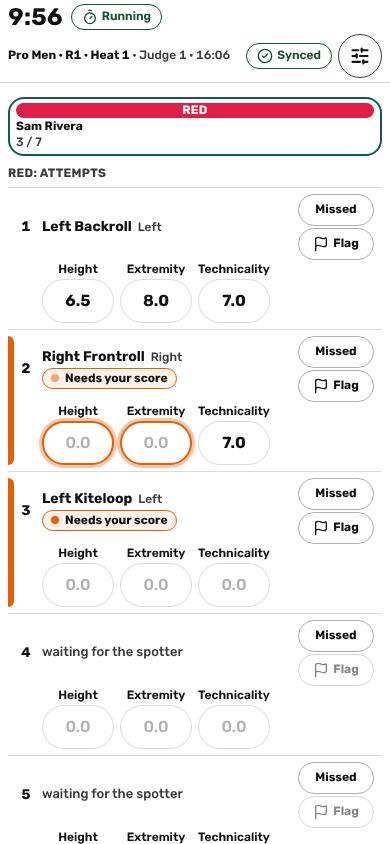
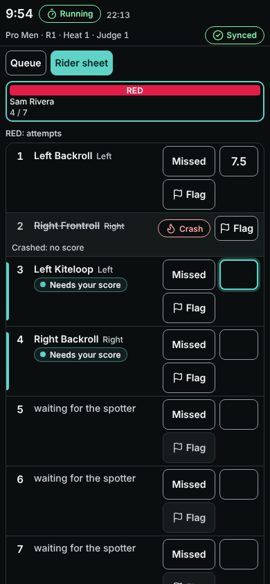

# Judge screen

The judge's phone at /judge/‹event›: the Rider sheet during the heat, then the Impression / Variety score for every rider and Submit.

Last checked: 17 Oct 2026 · Product version 0.24.4

## What it is for {#ju-purpose}

Judges watch the water, not the phone. Every judge, in every division, scores on **one screen: the Rider sheet** (since 0.24.0 there is no other view and no switch, so every official learns one screen and nobody ends up on the wrong one). Each attempt the spotter logs appears on its numbered line within about a second; you score it on that line, or before it is logged. Scores are sent through a queue on the phone: with no signal they wait (“Pending ‹n›”) and are sent when the signal is back, without duplicates (“Synced”). The screen opens the heat of the judge's panel by itself. The head judge's **Score** tab and an observer watching a judge show the same Rider sheet.

*judge-rider-sheet-390.png — the Rider sheet: Red's seven lines, the Rider label, the trick names the spotter logged, Missed and Flag on every line and a score box on each. (The badge reads “Offline” in the pictures only because the browser of the screenshot machine reports no network; on a phone with signal it reads “Synced”.)*

## Controls {#ju-controls}

| Control | What it does |
|---|---|
| Header | Heat and seat name, the slim timer — with the Flags on, the **flag strip** (the flag's colour, its words, the countdown and the heat name; scoring opens at **green**, not at the yellow; [Flags](flags.md)) —  (Running / Paused / Time up / On hold), the connection badge (**Synced**, **Pending ‹n›**, **Offline**, **Failed — tap to retry**), the time now, and the one round **Settings** button (see [The New look](#ju-new-look)). |
| Rider cards | One Rider label per rider (colour word, name, nationality, attempts used). Tap a rider to see their sheet. They stay at the top when you scroll. |
| A line | The attempt number, the trick the spotter logged (“waiting for the spotter” until then), **Missed** over **Flag**, and a score box. In a division scored by criteria the box is one box per criterion under the trick ([see below](#ju-criteria)). |
| Score box | Type the score with the phone keyboard; there is no Save button. Values off the scale's step are refused: the box is outlined in red and says why under the line (“That score is not on the 0.5 step. Use 7 or 7.5.” with a **Learn more** link to [this page](#ju-pad-step)), and the database refuses them too. |
| **Missed** | “I did not see it. No score from me; the panel average uses the others.” |
| **Flag** | “alert the head judge. I still score.” — That was a crash / That was a landing / Wrong rider / Duplicate / Other. |
| **Log an attempt** | Only when the Event step allows judges to log attempts: under the rider's name, opens the spotter's logger for that rider. |
| Impression step (named by the Event step's **Name of the impression score**: “Variety score”, “Impression score”) | After the heat ends: one score per rider (a summary card above the pad: attempts, landed, crashed, repeats, left / right, landed tricks with your scores), “‹done› / ‹total› riders”, **Submit** (“Submit your scores? You cannot change them afterwards.”). Submit is on when every rider has a score. |
| **Settings** (round button at the end of the header) | Opens a small sheet with Daylight / Dark, Normal / Large and Sound (sound is off until you tap it); remembered on this phone only. A second tap, **Esc** or a tap anywhere else closes it. There is no settings row at the bottom of the screen any more. |

After Submit, or when the head judge takes the heat into review, scores are locked (“Your sheet is locked. Ask the head judge to reopen it.”); the head judge can reopen one judge's sheet or edit a score with a reason.

## Rider sheet {#ju-rider-sheet}

The judge's one view (since 0.24.0; it was the default since 0.20.0), for scoring the jump the moment you see it, without waiting for the spotter. There is no switch and no other view: a phone that chose the old Queue before also opens on the Rider sheet, also after a reload, and so does the head judge's **Score** tab and an observer watching a judge. (The old Queue is still in the product's code, hidden, and can come back later; no setting or address on the live site opens it.) A division scored by criteria (Height, Extremity…) has the same sheet with one box per criterion ([below](#ju-criteria)).

- **The rider cards** (Rider label, name, nationality, attempts used) sit across the top. Tap a rider to see their sheet below.
- **The lines.** Every line is there from the start of the heat: as many numbered lines as the division allows attempts (7 for Arrow), numbered 1, 2, 3…, none hidden or folded, and none greyed like a crash. With **no limit** the sheet starts with **10 lines**, like the spotter's, and **every time you fill the last line a new empty line appears underneath it at once**, so you never run out of lines. You can score up to 10 lines past the attempts the spotter has logged; a line further down is shown but closed, and tapping it says so in one line (“Line 14 is not open yet: the spotter has to log more attempts first.”). **The rider cards stay at the top** under the header when you scroll down to the lower lines, so you can switch rider from anywhere on the sheet. An empty score box shows nothing (no grey 0.0 that looks like a score of zero). If the head judge adds an attempt past the limit, it gets its own line. The spotter's trick names appear on their lines as they are logged.
- **Line by line, and you never wait for the spotter.** So a score never lands on the wrong attempt, you type on **the first line of that rider that has no score from you yet**, whether or not the spotter has logged that attempt: if the spotter is two jumps behind you still score the third jump the moment it lands. A score typed ahead is your private note and counts as a score for this rule, so typing ahead line after line always works; it attaches to the rider's next logged attempt, in order. A line with your score or note, a line greyed by a **crash** and a line set to **Missed** all count as done. Every line up to the first empty one can still be changed until Submit, and a Missed line can still be given a score.
- **Lines that need your score are highlighted.** A line where the spotter has logged the attempt and you have no score yet has a slim **orange** bar on its left edge (orange is used for nothing else) and a small rounded tag **Needs your score**. Only the line you type on next, the first line without a score from you, also has a gently pulsing dot (still when the phone is set to reduce motion) and a soft glow around its score box; when you score it, the pulse and the glow move to the next one. Red stays for crashes and Lycra. A line you filled ahead of the spotter never lights up when the spotter logs it, not even for a moment, and a crash line never lights up. An empty line the spotter has not logged yet is not highlighted (there is nothing to score yet). The words go with the colour: colour is never the only sign. Daylight and Dark both meet the beach standard (the tag's words at 7:1 or better).
- **Tapping a line below an empty one.** The only thing that holds you is your own empty lines above. Tapping a lower line never does nothing: it asks once, in one line (“Lines 1–2 have no score from you. Set them to Missed and score line 3?”), and one tap on **Set to Missed** sets them to Missed and opens the line you tapped. **Not now** leaves everything as it was.

*judge-rider-sheet-skip-390.png — line 7 tapped while lines 3 to 6 have no score from you: the question and its one tap.*
- **The reference score (“Ref 7.0”).** Beside a trick the spotter has logged, a small teal tag shows what an average version of that trick is worth on the judges' list, plus what its variations add. It is **a hint, never a score**: nothing is saved or counted because of it, it is not shown to the public, and you type your own score as always. **Tap the tag** to see how it is made (“Reference 7.0 = Boogie loop 4.0 + Board flip 2.5 + Blind landing 0.5.”); **Hide** closes it. Board-off, Board flip and Osmosis do not add up: only the highest counts, and the sentence says which was left out. Board spin (+2.2) is another trick than Board flip (+2.5), in the same group. A multiplier (×2, ×3) plays no part for now: a ×2 trick shows the hint of the single one. A trick the head judge typed or corrected as plain words is read again with the trick base and gets its tag when every word is recognised. There is no tag on a crash, on a trick that is not on the list (Innovation, say), or when the trick has a block the list has no value for (a Tic-tac, a grab on any trick but the kiteloop). The values are the platform owner's, in [Admin: trick base](admin-trick-base.md#at-reference).
- **Missed is a switch.** If you did not see an attempt, tap **Missed** on its line: the button shows it is on (a tick) and the score box stays empty. Tap it again to turn it off; typing a score on a Missed line turns Missed off by itself, so you never clear anything first. It counts as done and opens the next line, and means “I did not see it. No score from me; the panel average uses the others.”, also on a line the spotter has not logged yet: the attempt that takes the line then has no score from you, and the console shows “Missed” in your column. Turning it off puts the line back to “no score from you”; the audit log says “‹judge› took back Missed on ‹attempt›”.
- **Flag.** Under **Missed** on every line with an attempt (also a crash line) is **Flag**, a small pill with a flag icon and the word (a screen reader says “Flag attempt ‹n›”): it alerts the head judge (“That was a crash” / “That was a landing” on a crash line / Wrong rider / Duplicate / Other) and you still score or set Missed. On a line with no attempt yet it is greyed.
- **Each line** shows the attempt number, the trick (empty — “waiting for the spotter” — until the spotter logs it; then the trick as the spotter named it, with its direction), a **Crash** word when the spotter logged a crash, and a **Missed** button and a score box you type into with the phone keyboard. The box uses the division's scale and step; a score off the step is refused with the same sentence as the pad (“That score is not on the 0.5 step. Use 7 or 7.5.” with a **Learn more** link to [this page](#ju-pad-step)). There is no Save button: a score that is on the step is saved the moment you type it.
- **Typing before the attempt exists.** A score typed on an empty line is your private note: it shows **pending** and is kept on the server at once, so it survives a phone reload or a dead phone. Nobody else sees your notes except the head judge and an observer; they are never counted, never published and never shown to the public.
- **When the spotter logs.** The attempt takes the rider's lowest-numbered line with no attempt, and your note on that line becomes your score on the attempt at once — **by order of logging, never by the time you typed**. A note typed ahead for line 3 waits for the third attempt. If the spotter logs a **crash**, that line greys, shows **Crash**, and any note on it is thrown away (judges never score crashes).
- **Changing a score.** Type a new value on any line until you Submit. The console follows; the audit log keeps every change (“J2 changed attempt 3 from 7.0 to 8.5 at 14:21:05”).
- **If the spotter's Undo removes an attempt that had taken your note**, the note goes back to pending on that line: the trick text vanishes from the line and your score stays, shown as pending, until the spotter logs the right attempt. (If a later attempt of the rider has been logged already, nothing moves and the score stays on the removed attempt.)
- **If the head judge clears your note** from the console (your phone was dead, say), the line shows empty again within a second.
- **If the head judge deletes or merges an attempt**, the lines renumber and the notes behind it move up to the next real attempt; the scores on the deleted attempt go as they always do.
- **At the end of the heat.** A note that never got an attempt shows **no attempt logged here** with **Clear**. **Submit** is refused while you still hold one (“You still have scores with no attempt: Red, attempt 4. Clear them, then submit.”): the Impression step shows the same sentence with **Open the Rider sheet**. Press **Clear** on each line, then Submit.
- **Taking a score back, or a crash called wrong.** A line greyed by a crash has **Flag** with “That was a landing”: the head judge decides. A line you scored by mistake can be changed by typing the new score; a score you gave can never be deleted, only changed (or set to Missed).
- **Log an attempt.** When the Event step lets judges log attempts, a **Log an attempt** button sits under the heading of the rider's sheet (while the heat is running). It opens the spotter's logger for that rider and nothing else changes.

### A division scored by criteria {#ju-criteria}

*judge-rider-sheet-criteria-390.png — three criteria: each name above its box; line 1 is scored, line 2 has one box typed and waits for the other two, the lines below wait for line 2.*

In a division scored by criteria (Height, Extremity, Technicality…) the line is the **same line** (the attempt number, the trick, **Missed** over **Flag**) with **one score box per criterion** in place of the single box, in the division's order: each criterion's name above its box, side by side under the trick. On a 390 px phone they wrap onto a second row when they do not fit (five criteria make two rows) and none is ever off the screen; a box is never smaller than the single score box. A long criterion name is shortened with “…”; the whole name is read out by a screen reader.

- **Each box works like the single box.** A typed value is checked on **that criterion's own range and step** and refused in the same words when it falls between two steps (“That score is not on the 0.5 step. Use 7 or 7.5.”). Fill the boxes of a line in any order.
- **A line is done when every criterion has a score**, or when it is **Missed** or greyed by a **crash**. Only the first line that is not done takes typing; the lines below wait, exactly as with one score. **Missed** and **Flag** work on the whole line.
- **The trick score is worked out for you** from the criteria as the pad always did, and is saved the moment the last box is typed. A line that is not complete yet is not sent: it waits on your phone (and is still there after a reload) until the last criterion is typed.
- **Before the spotter logs.** A line you complete ahead of the attempt is your private note, like a single score: it waits on the line and becomes your score on the attempt when the spotter logs it; a crash throws it away. Your criteria and the trick score are exactly what the old Queue wrote, so the console, the panel score, the Impression card, Publish and the public pages show no difference.

*judge-rider-sheet-390.png — Red's sheet with all 7 lines in Daylight: four attempts logged (the second a crash), lines 3 and 4 with the orange bar and the "Needs your score" tag (only line 3 pulses and glows), empty score boxes, and Missed and the flag-icon pill side by side on every line.*

*judge-rider-sheet-dark-390.png — the same sheet in the Dark theme.*

## The New look {#ju-new-look}

Since 0.21.0 every screen of the product wears the same look as the Instagram posts: near-black and white with **teal**, the font Rubik (Bold for rider names, heats, the timer and scores), pill buttons, and **rows with thin dividers instead of boxed cards**.

- **Daylight is the default** on every page (the front door too) and reads in full sun (white page, near-black text). **Dark** is a choice on the **Settings** button (on the front door, the Daylight / Dark switch at the top): a true near-black page with white text. **Teal** is the one accent: every button, every selected state and every focus ring. **Orange** is kept for one thing, **"Needs your score"** (the bar, the tag's frame and the glow), and for the logo.
- **Normal is one step smaller** (13 px text, rider names 14 px). **Large** is the size Normal was before. Tap targets are at least 44 px in both, except the two small stacked pairs beside a trick name (see below), which are at least 32 px; the text inside every typed-in box is at least 16 px.
- **The header is one clean bar** (all white in Daylight, near-black in Dark). With the flags on, **the flag strip has the first row to itself** (the flag's colour, the timer and its full words, which wrap instead of ending in "…"); below it the heat, your seat and the time, then the sync state and the round **Settings** button. Without flags the first row is the timer.
- **White buttons with a thin edge.** Buttons and boxes at rest are white (Daylight) or near-black (Dark) with a thin light-grey edge: no grey blocks and no thick dark outlines. A button that cannot be pressed keeps its shape with faded words. A selected switch, rider card or tab is teal. 
- **The trick name is the main thing on the Rider sheet.** On each line **Missed** sits over **Flag** in one small column between the trick name and the score box; the trick name has the rest of the width and wraps to two lines instead of being cut. An empty score box shows **0.0** as a light-grey hint that disappears when you type.

## A typed score that is off the step {#ju-pad-step}

The score box accepts any typing. A typed score between two steps (7.25 on a 0.1 step) turns the box red, is not saved and shows the same sentence the database would give, naming the step and the two nearest allowed scores (“Use 7.2 or 7.3.”). A score outside the scale says so (“That score is outside the scale (0 to 10).”). Type one of the allowed scores. In a division scored by criteria the check is made on each criterion's own range and step. The head judge's score and sheet entry use the same pad and show the same sentence.

## What it depends on {#ju-depends}

The judge's seat must be on the panel of the running heat's division (Officials → Panels): otherwise “You are not on the panel of a heat that is running.” Between heats: “No heat of your panel is running. This screen opens it by itself.” and the next heat with its estimated time. Joining: [Join page](public-join.md). iPhone: add the join page to the Home Screen first and join inside the home-screen app (it keeps its own login and unsent scores).
