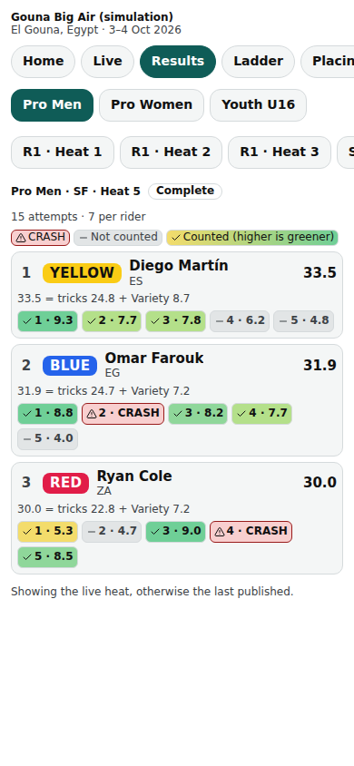
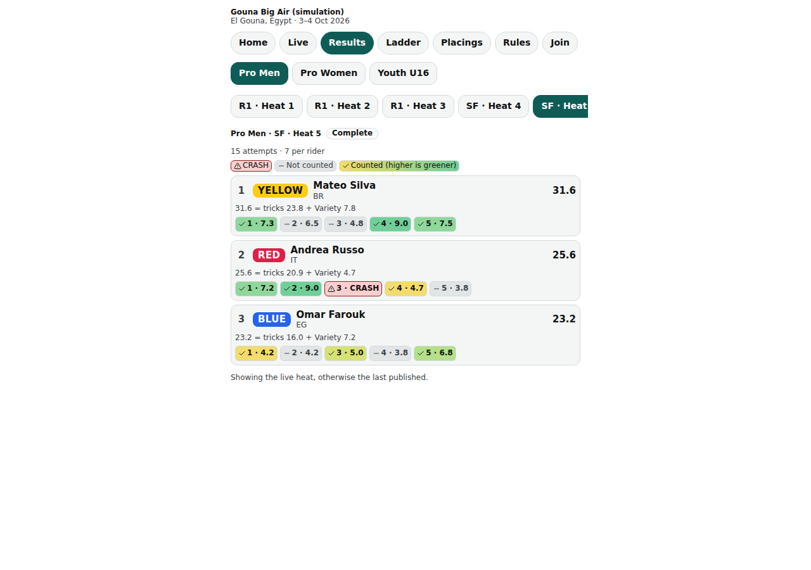
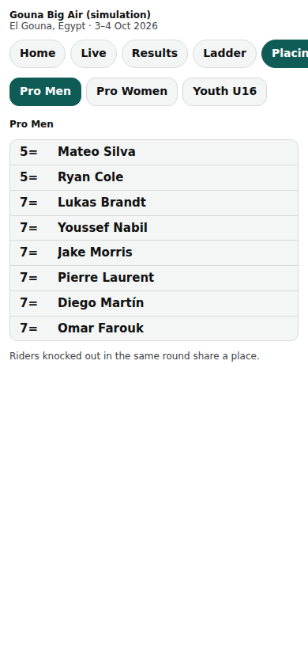

# Public: results and placings

/e/‹event›/results (one tab per heat) and /e/‹event›/placings (final places and the highest jump).

Last checked: 14 Oct 2026 · Product version 0.23.0

## What it is for {#pr-purpose}

The published result of every heat, readable on a phone in the sun, and the division's final placings.

*public-results-390.png — a heat summary: one row per rider, the formula in words and the attempt boxes.*

*public-results-1280.png — the same on a laptop.*

*public-placings-390.png — placings with shared places (“13=”) and the highest jump.*

## Controls {#pr-controls}

| Control | What it does |
|---|---|
| **Divisions** and **Heats** tabs | Pick the heat; it opens on the live heat, otherwise the last published (“Showing the live heat, otherwise the last published.”). |
| Rider rows | Place, Rider label, total and the formula in words (“20.5 = tricks 15.5 + Variety 5.0”; “ + bonus”, “ − penalty” when they apply; a percentage only when the division's “Show scores as % of maximum” is on); DNS, DNF, DSQ. |
| Attempt boxes | In attempt order: crash red with CRASH, not counted grey, counted graded yellow (lowest in the heat) to green (highest), each with an icon or a word. What a box shows is the division setting “What spectators see per attempt” (Divisions → Scoring → ‹n› more settings → Live screens): attempt number + score, trick name + score (what a new division starts with), or scores only. With **trick name + score** a box reads the number, the trick in the short form riders say, then the score: “1 · L ×2 BR · 7.33” (L or R is the side the spotter set; BR is Backroll, FR Frontroll, KL Kiteloop, ×2 and ×3 stay; the whole short-form list is under *Short trick names* below). A crash reads “2 · CRASH” with no trick; an attempt whose trick the spotter has not logged yet reads “1 · 7.33” and fills in by itself. A trick shows only where its score does: with live scores off, tricks appear once the heat is published, together with the scores. On a narrow phone the boxes wrap onto new lines as before; when one box is still too wide for the card only its trick part ends in “…” — the number and the score are never cut — and the full text is in the box’s accessible label. The other two settings look exactly as they always did. The same boxes are on the Live tab, a rider’s page and Follow the heat. |
| “How to tell the riders apart” | The Lycra colours and how riders are recognised. |
| **Placings** | Final places (riders knocked out in the same round share a place, “13=”), and “Highest jump: ‹h› m — ‹rider› (‹trick›)” when heights are measured. |

“No results have been published yet.” · held result: “Result to be announced.”

## Short trick names {#pr-short-tricks}

With “trick name + score” the trick is written the way riders say it. The side comes first (**L** or **R**, from the spotter’s L / R; nothing when no side was set), then each word of the trick. Capitals, spaces and hyphens do not matter (“back roll”, “Back-roll” and “BACKROLL” are the same word). A typed “double” or “triple” becomes ×2 or ×3. A word that is not in the list stays as the spotter typed it.

| Spotter’s word | Shown as | Spotter’s word | Shown as |
|---|---|---|---|
| Straight jump | Jump | Board-off | BO |
| Backroll | BR | One-foot | 1ft |
| Frontroll | FR | Board spin | Board spin |
| Kiteloop | KL | Handle pass | HP |
| Megaloop | Mega | + Kiteloop | +KL |
| Double loop | DL | Late | Late |
| Triple loop | TL | Late rotations | Late rotations |
| S-loop | S-loop | Tic-tac | Tic-tac |
| Contra loop | Contra | Grab (Indy, Tail, Nose, Melon, Mute, Stalefish, Method) | as typed |
| Doobie loop | Doobie | Blind landing | Blind |
| Boogie loop | Boogie | Toeside | Toeside |
| Late backroll | Late BR | Downloop landing | Downloop |
| Late frontroll | Late FR | ×2 / double, ×3 / triple, ×4 / quad | ×2, ×3, ×4 |
| Heart attack | Heart attack | | |

Example: Left, ×2, Backroll, Board-off, Handle pass is shown as “L ×2 BR BO HP”.

## What it depends on {#pr-depends}

A heat appears after the head judge publishes it **and** either “Show results automatically when a heat is published” is on or the result was released ([dependency map](../dependencies.md#dep-public)). A held final shows nothing until **Release result**.
