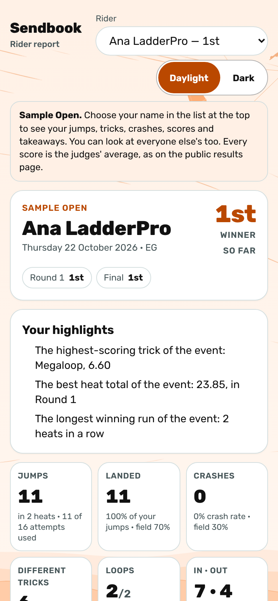
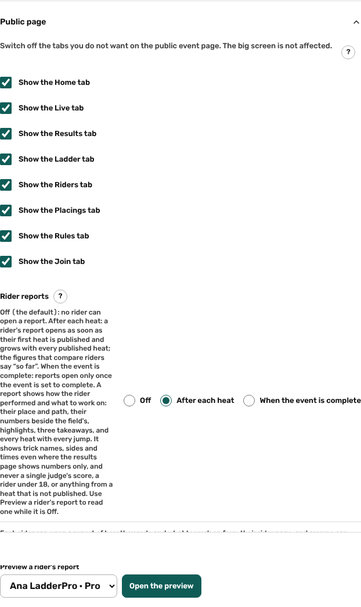
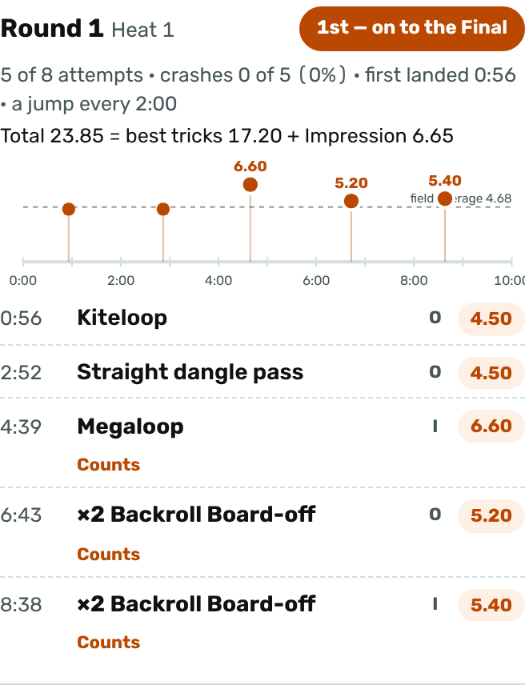
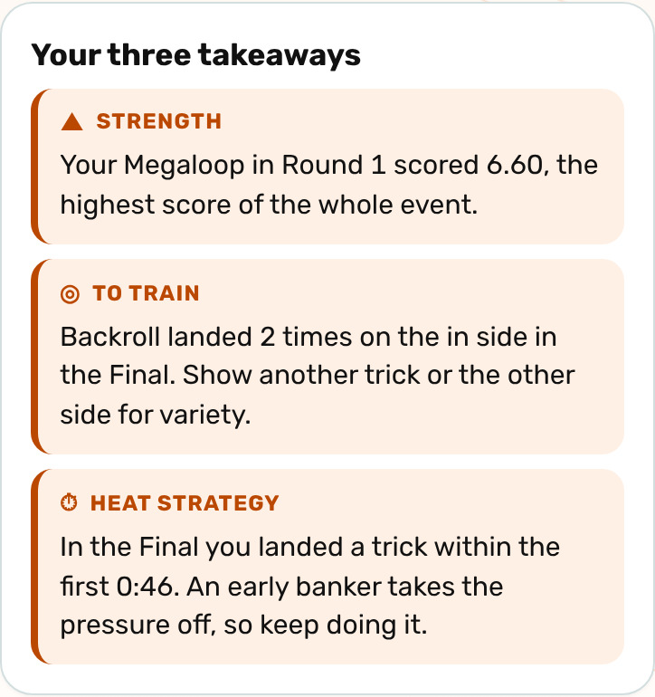
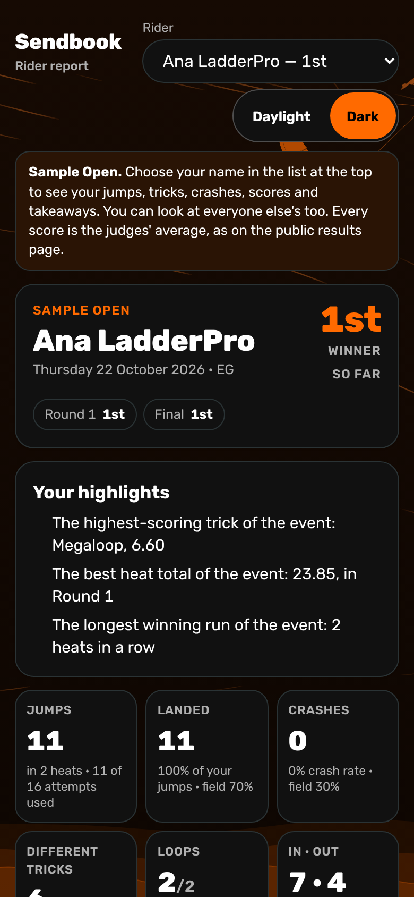
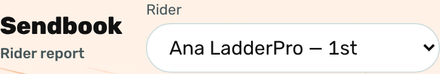

# Public: the rider report

/e/‹event›/riders/‹id›/report: how one rider performed and what to work on, for the rider and for anybody who looks at it. It exists only when the organiser switches **Rider reports** on (Event step → **Public page**).

Last checked: 22 Oct 2026 · Product version 0.26.0

## What it is for {#prr-purpose}

A rider opens **Open the report** on their own page (from the **Riders** tab, from Results or Ladder, or from a shared link) and sees where they finished, the path they took through the rounds, thirteen numbers, three things to take away and every heat jump by jump. At the top, the **Rider** list holds every rider whose report is open: choose a name to read that rider's report. Anyone can open any rider's report. No login is needed.

*public-report-390.png — the top of a report: place, path and the numbers beside the field's.*

## The setting {#prr-setting}

The Event step → **Public page** → **Rider reports** has three choices:

- **Off** — the default for every event, old and new. The rider page has no link and the report address answers “not available”.
- **After each heat** — a rider's report opens as soon as their first heat is published and grows with every published heat. The report says it is **so far**, and so do the parts that compare riders (the place, the highlights, the field's figures).
- **When the event is complete** — reports open only once the event is set to complete.

While it is Off, or before the report opens, the organiser (and the platform owner through **Open as this organiser**) can read any rider's report with **Preview a rider's report**, in the same card: pick the rider and press **Open the preview**. The preview says it is for the organiser; the public cannot read it.

*organiser-event-rider-reports-1280.png — the three choices and the preview.*

**Switching it on makes trick names, sides and times of published heats public**, also in a division whose results page shows numbers only. It never shows any single judge's score (J1, J2…), the judges' reference hints, a score still being entered, anything of a heat that is not published, or a rider's contact details.

## What the report shows {#prr-parts}

| Part | What it shows |
|---|---|
| **Rider** list | Every rider whose report is open, with the place (“Ana Sample — 1st”) or the round reached (“Ben Sample — reached Round 3”). Choosing one opens that rider's report. In the organiser's preview it lists only the riders of that event. |
| Note | One line under the list: the event, the place, and that every score is the judges' average, as on the public results page. |
| Top card | The event, the rider's name, the day(s) and country, and the final place (**Joint 5th** for a shared place) or the round reached (**Out in Round 3**). **so far** while the event is not complete. Under it, the path: one pill per round with the place or **Walkover** / **Did not ride** / **Out of the event**. |
| **Your highlights** | Up to three lines, where the rider was first in the division: highest scoring trick, best heat total, longest winning run, the only rider to land a trick, most tricks, most different tricks, most loops, fewest crashes, best score of the event's name for the separate score. No highlight, no card. |
| **Tiles** | Thirteen, in a fixed order, each with the field's figure beside it: jumps, landed, crashes, different tricks, loops, the two sides, best trick, average trick, the separate score, heats won, average heat total, best heat total, steadiness (**lower = steadier**; it needs two heats with a total). The last seven are tinted. |
| **Your takeaways** | One strength (▲), one thing to train (◎) and one heat strategy point (⏱), chosen by fixed rules ([the rules](#prr-rules)). The strategy point may be the gap line: “In the Final you were 2.0 points from 1st place. One more trick scoring above 6.5, in place of your third-best (4.5), would have moved you up.” |
| **Your best tricks** | Three numbered, each trick once with its best published score and where it was landed. |
| **Heat by heat** | A header with the lycra colour, the round, the heat number and the result (**1st – on to the Final**, **1st – Winner**). Then attempts used, crashes, first landed trick, pace, the total written as best tricks + the separate score, the gap, a **timeline** (a dot for every landed trick at its time and score, a cross for every crash, a dashed line at the field's average, the counting tricks larger with their score), and every jump: time, trick (**Trick not logged** when it has no name), side letter, the published score or **Crash**, and **Counts** under the counting tricks. |
| **Trick mix** | A bar by family of the trick base, with the grey **Not logged** part, landed out of tried and the average; **Landed** and **Still to land**; and “N crashes had no trick name logged.” |
| **You and the field** | Landing rate, attempts used, jumps with a loop, different tricks a heat, average landed trick and the separate score: **You**, **Field** and **Finalists**, with the value on the right. Field figures are averages; no other rider is named there. |
| **My notes** | **Suggested goals from this report** (the first two things to train) and three prompts to think about: What went well? What will I work on? My goal for the next event. There is nowhere to type and nothing is saved. |

*public-report-heat-390.png — the total, the timeline and every jump of one heat.*

*public-report-takeaways-390.png — a strength, something to train and a heat strategy point.*

Names come from the event: the separate score is called what the event calls it (**Impression**, **Variety**…), and the two sides are the words the event shows (**Left / Right** or **In / Out**). All scores are the published panel scores, exactly as the Results page shows them. Two spellings of one trick (“Double backroll board off”, “×2 Backroll Board-off”) count as one trick; words the trick base did not recognise stay as typed and count as their own trick.

## Day and Dark {#prr-theme}

The report follows the page's Day / Dark choice and has its own **Daylight / Dark** switch at the top, the same choice that is kept on the device everywhere. Its words are at least 4.5:1 against their ground. The Sendbook background (air streams, low water and the kiter) is part of the page: the kiter stands beside the report on a wide screen and small at the top right on a phone, and nothing moves when the phone asks for less motion.

*public-report-dark-390.png — Dark.*

*public-report-picker-390.png — the Rider list at the top.*

## The rules for the takeaways {#prr-rules}

- **Strength** (the first that applies): a best trick among the event's five highest scores; two or more loops landed; growth through the day (landing rate up by 25 points or more from the first heat to the last); landing rate at least 8 points above the field; every attempt used in every heat (when the division has a limit); the separate score a quarter above the field's; more different tricks a heat than the field; a trick landed on both sides; growth from the first heat's total to the last.
- **To train** (the first that applies): no loops while the finalists' jumps include loops; one side on at least 75% of the jumps with a side (only with 8 such jumps, and at least half the rider's jumps); landed tricks averaging below three quarters of the finalists' average; a heat with half or more of the jumps crashed; loops landed less than half the time; a trick tried at least twice and never landed; the same trick landed twice on the same side in one heat; the separate score a quarter below the field's. The first two that apply are the suggested goals.
- **Heat strategy** (the heats lost first, then the heats won): the gap line first, for the latest heat that was not won; then, in a heat not won — attempts left unused, the winner landing fewer tricks, a first landed trick after half the heat, the winner landing more loops or more tricks, or as many tricks as the winner; in a heat won — a counting trick banked in the first third, or the best trick in the second half.

## Who has no report {#prr-none}

A rider whose date of birth says under 18 has no report and no link; the address answers the same “not available” as for a closed report, so nothing says why. A rider with no published heat yet is told the report opens with the first one. A report is kept out of search engines.

## What it depends on {#prr-depends}

The event must be public, **Rider reports** must not be Off, the rider must be in a locked draw with a published heat. It reads through one database function (read as a visitor and shared for 3 seconds with the other public pages), so a report costs no extra read per visitor.
