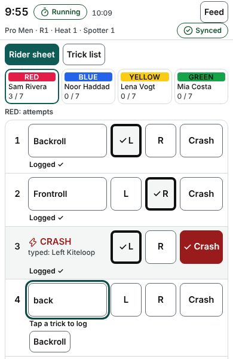
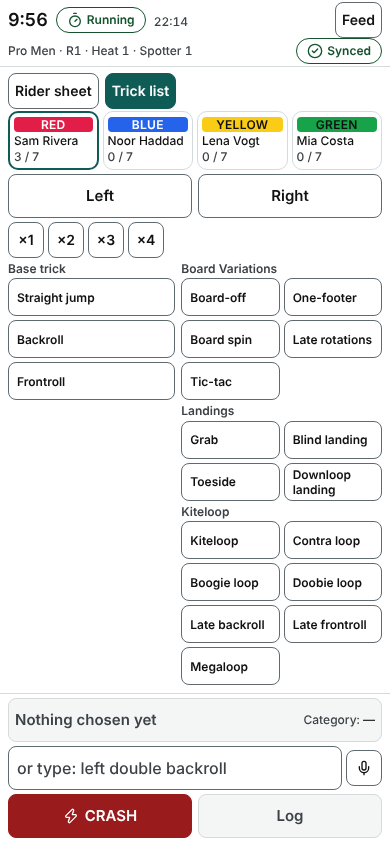
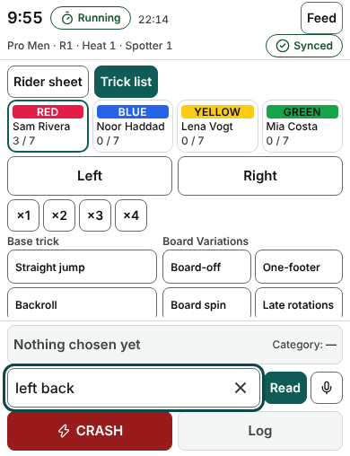

# Spotter screen

The spotter's phone at /spot/‹event›: log every attempt — which rider, which trick, landed or CRASH — the moment it happens.

Last checked: 11 Oct 2026 · Product version 0.20.0

## What it is for {#sp-purpose}

What the spotter logs is what the judges score: each attempt appears on every judge's phone within about a second. The screen opens the running heat by itself and shows the next heat between heats.

The screen has two views, chosen with the switch at the top: the **Rider sheet** (the default) and the **Trick list**. The choice is remembered on that phone: a phone whose spotter picked a view keeps it after a reload; every other phone opens on the Rider sheet. The “?” of the switch says: “Rider sheet: one numbered line per attempt; a line logs itself when you pick the trick or turn on Crash. Trick list: build the trick with taps and press Log.”

## The Rider sheet {#sp-rider-sheet}

Like the judges' Rider sheet, but the spotter fills in the lines and **nothing needs a Log press**.

*spotter-rider-sheet-390.png — three attempts logged (the third a crash), line 4 being typed with its suggestion under the box.*

- **The rider cards** (Rider label with the colour word, name, nationality, “n / max” attempts) sit across the top. Tap a rider to show that rider's sheet. Assigned riders come first; **Other riders** shows the rest.
- **The lines.** One numbered line per attempt, empty until it is filled in: as many lines as the division's attempt limit (7 for Arrow). With **no limit** there are 10 lines from the start and an **Add attempt** button under the last line adds one more line each time it is pressed.
- **Each line** has the attempt number, a **trick box** (type the trick), two small buttons **L** and **R** for the direction (only one can be on; tapping the other switches; the one that is on has a thick border and a tick), a **Crash** toggle, and its state in words: **Empty**, **Saving…**, **Logged ✓**.
- **Only the first empty line takes typing.** The lines below wait (their boxes and buttons are greyed) until the line above is logged.
- **How a line logs itself.** As soon as it has a trick or Crash is on. The trick counts as entered when you **tap a suggestion** (the tricks that start like what you typed show under the box: type “back”, tap **Backroll**), or, for text that matches no suggestion, once you have **stopped typing for about 2 seconds**. Words that match nothing stay free text and are flagged for the head judge (the line says “Free text: the head judge will check it”). **L** and **R** can be set before or after; L or R alone is not an attempt. There is no Log button and no keyboard key that logs (the keyboard's Done only closes it). The line then becomes that rider's next attempt and reaches the judges and the console exactly like an attempt logged from the Trick list.
- **Changing a line afterwards.** Every later change to a logged line (the trick, L / R, Crash) updates the **same** attempt within a second on the judges' phones and the console, never a second attempt. The judges' scores stay on the attempt, as when the head judge edits one. You can change the attempts **your own seat** logged until the heat is published; every change leaves a line in the audit log in words (“Spotter changed Red 3: Backroll Left → Frontroll Left”). Emptying a trick box does **not** delete the attempt: use **Undo** (Trick list, first 10 seconds) or ask the head judge to delete it in the console.
- **Crash.** Turning Crash on logs the line at once as a crash, as the CRASH button of the Trick list does: the judges' line greys and takes no score. The line shows **CRASH** in place of the trick, with the typed trick kept small under it (“typed: Frontroll”), so a rider's dispute can be checked later. A crash needs no trick. Turning Crash off makes it a normal attempt again.
- **Attempts logged by anyone** (a second spotter, the head judge) show in their lines, live and in order, labelled “Logged by another seat”; they cannot be changed from this phone, and the next empty line is always the next attempt.
- **The keyboard.** While the keyboard is open the whole screen is as tall as what the keyboard leaves free: the line being typed, with its L, R and Crash and its suggestions, moves up to sit just above the keyboard, so you see what you type.

## The Trick list {#sp-trick-list}

*spotter-390.png — riders in one row with attempts used; Left and Right as two wide buttons; multipliers, base tricks, add-ons and grabs; the text box, then CRASH and Log fixed at the bottom. (“Offline”: the browser of the screenshot machine reports no network.)*

Three things to know about the layout:

- **The trick text box is at the bottom of the screen**, directly above Log and CRASH.
- **Left and Right** are two wide buttons sharing the full width of their row (half each); the selected one has a thick border and a tick (never colour alone).
- **With the keyboard open**, the text box, Log and CRASH sit directly above the keyboard: you see what you type and tap **Log** without closing the keyboard. Logging stays on the **Log** button; no keyboard key logs (Enter only reads the words into blocks).

*spotter-keyboard-390.png — the Trick list at the height left above a phone keyboard (390 × 508): the typed words, CRASH and Log are all in view.*

## Controls {#sp-controls}

| Control | What it does |
|---|---|
| Header and **flag strip** | The clock line is the **flag strip** (flags on): the flag's colour, the state's words, the countdown and the heat name. The logger opens at **green** (Running), not at the yellow; at the last minute it stays open; at red (Finished) it closes as before. It covers none of the buttons ([Flags](flags.md)). |
| View switch | **Rider sheet** / **Trick list**, remembered per phone. |
| Riders row | One Rider label per rider with attempts used (“5 / 7”). A rider who used every attempt turns grey: “Out of attempts · 7 / 7”, and Log is off for them. Assigned riders first when the spotter is assigned. |
| Direction | **Left** / **Right**: two wide buttons, half the row each, the chosen one with a thick border and a tick. |
| Trick builder | Multiplier, base trick, add-ons, grabs & landings, in the order set in Divisions → Trick base; the composed trick name shows above. **Or type the trick** (“left double backroll”) or **Speak** (where the browser has speech recognition); an unknown word is kept as free text for the head judge. |
| Trick text box | Just above CRASH and Log; stays above the keyboard. |
| **Log** | Logs a landed attempt (“Logged — ‹rider› — attempt ‹n›”). |
| **CRASH** | Asks once: “Log a crash for ‹rider›?” → **Yes, log CRASH**. |
| **Undo** | Takes back the last attempt for 10 seconds (Trick list); after that “Too late to undo: ask the head judge to delete it.” |
| **Feed** | What has been logged in this heat; “Possible duplicate” when two spotters logged the same rider within the duplicate window. |
| Connection badge | Synced / Pending / Offline / Failed — tap to retry, as on the judge screen. |

## What it depends on {#sp-depends}

The heat must be running (“The heat is not running, so nothing can be logged.”; paused: “Paused — logging is off until the head judge resumes.”). The rider must have attempts left (the division's cap; past the cap only the head judge adds one, with a reason). The trick blocks come from the division's Trick base. Judges can log too when the Event step allows it.
